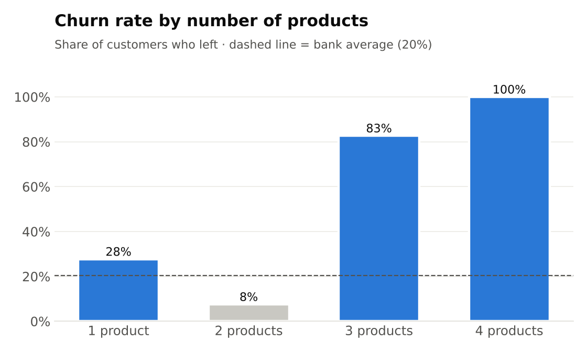
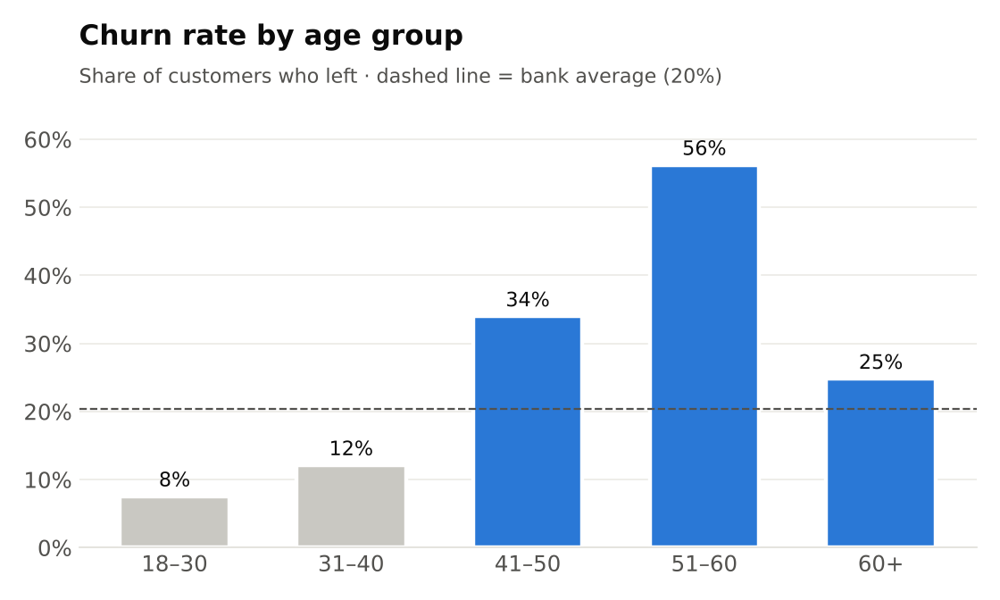
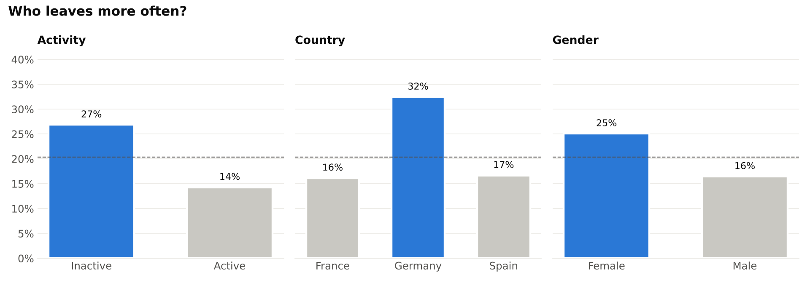
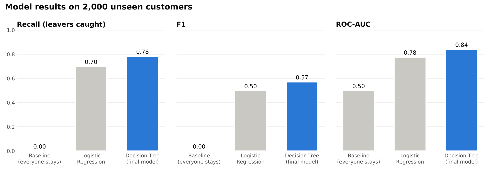
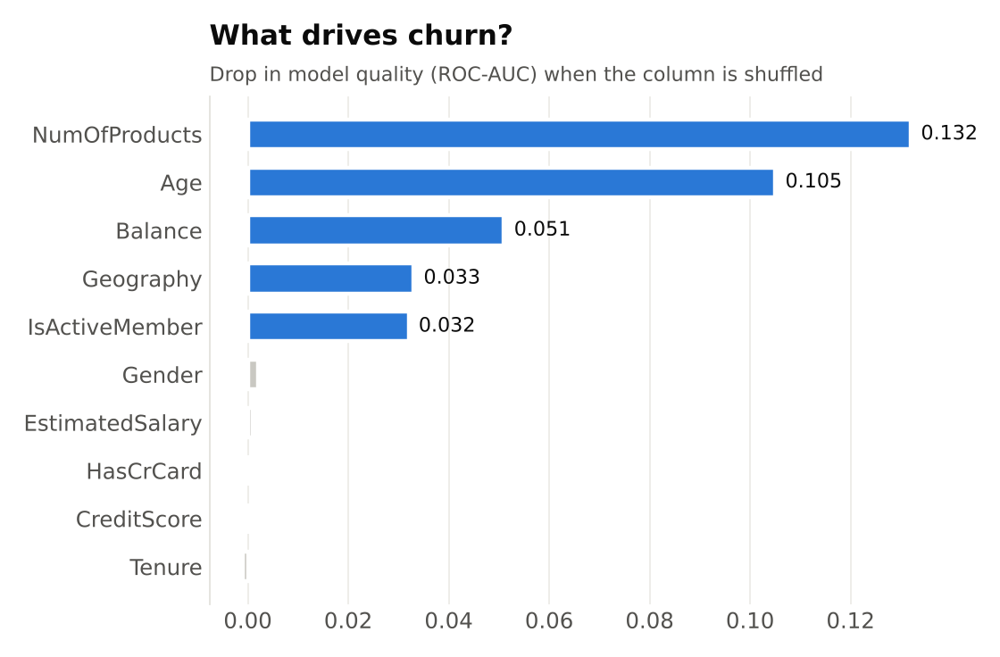

# Bank Customer Churn Prediction

**Which bank customers are about to leave, and what can the bank do about it?**

Keeping an existing customer is much cheaper than winning a new one. This project analyses 10,000 bank customers, finds the groups that leave most often, and builds a model that flags at-risk customers *before* they leave, so the bank can contact them in time.

| | |
|---|---|
| **Final model** | Decision Tree (written from scratch in NumPy) |
| **Leavers caught** | **78%** of customers who actually left (recall 0.78) |
| **Ranking quality** | ROC-AUC **0.84** on 2,000 unseen customers |
| **Top churn drivers** | number of products, age, balance, country, activity |

---

## 1. Business problem

About **1 in 5 customers (20%)** left the bank. Missing a customer who is about to leave costs far more than a retention call to a customer who would have stayed. So the goal is not just high accuracy, but **catching as many leavers as possible** at a reasonable number of false alarms.

## 2. Data

[Bank Customer Churn Prediction](https://www.kaggle.com/datasets/shantanudhakadd/bank-customer-churn-prediction) (Kaggle): 10,000 customers of a European bank (France, Germany, Spain), 14 columns: credit score, country, gender, age, tenure, balance, number of products, credit card, activity, salary and the target `Exited` (1 = left). The data is clean: no missing values and no duplicates.

## 3. Key findings

### Number of products is the strongest signal



Customers with **2 products** almost never leave (8%). Customers with only **1 product** leave more than 3× as often (28%). Customers with **3–4 products** leave in 83–100% of cases. This is a small group (326 customers), but a clear warning sign.

### Customers aged 41–60 are the highest-risk group



Churn rises sharply with age: 8% for customers under 30, **56%** for customers aged 51–60.

### Inactive customers, Germany and women leave more often



- **Inactive** customers leave twice as often as active ones (27% vs 14%).
- Customers in **Germany** leave twice as often as in France or Spain (32% vs ~16%).
- **Women** leave more often than men (25% vs 16%).

## 4. Model

Three models were built **from scratch in NumPy**, with no ready-made ML models:

| Model | Idea | Role |
|---|---|---|
| Baseline | always predicts "stays" | reference point |
| Logistic Regression | gradient descent on log loss | simple comparison |
| **Decision Tree** | CART with Gini impurity | **final model** |

- **No data leakage:** the data was split into train/test first, and every preparation step (scaling, encoding) was fitted on the training data only, inside a `Pipeline`.
- **Imbalanced classes:** leavers get a higher weight (balanced class weights), so the model does not ignore them.
- **Tree depth** (6) was chosen with 5-fold cross-validation on the training data. Deeper trees started to overfit.
- **Correctness check:** both hand-written models give exactly the same results as scikit-learn's versions.

## 5. Results



| Model | Accuracy | Precision | Recall | F1 | ROC-AUC |
|---|---|---|---|---|---|
| Baseline (everyone stays) | 0.796 | 0.000 | 0.000 | 0.000 | 0.500 |
| Logistic Regression | 0.714 | 0.387 | 0.700 | 0.499 | 0.777 |
| **Decision Tree** | **0.762** | **0.451** | **0.784** | **0.572** | **0.842** |

The baseline has the highest accuracy but **catches nobody**, which is why accuracy alone is misleading here. The Decision Tree wins because it captures non-linear patterns (2 products = safe, 3–4 = risky) that a single weight in Logistic Regression cannot.



### The threshold is a business decision

The model outputs a churn **probability**. Where the bank draws the line depends on what a retention action costs:

| Threshold | Leavers caught | Of flagged customers, really leaving | Customers to contact (of 2,000) |
|---|---|---|---|
| 0.3 (catch almost everyone) | 84% | 40% | 854 |
| 0.5 (default) | 78% | 45% | 708 |
| 0.7 (fewer false alarms) | 48% | 77% | 253 |

A cheap action (SMS, email) justifies a low threshold. An expensive one (personal manager call, bonus offer) justifies a high one.

## 6. Recommendations for the bank

1. **Move single-product customers to a second product.** The 2-product group is the most loyal (8% churn vs 28%). Offering a savings account or a card to single-product customers is the biggest retention lever.
2. **Review customers with 3–4 products.** 83–100% of them leave, so something in this offer is not working (fees, product fit or how the products are sold). This group needs to be investigated, not sold more products.
3. **Build a retention programme for customers aged 41–60**, the highest-churn age group (34–56%).
4. **Re-activate inactive customers** with targeted offers. Inactivity doubles churn risk.
5. **Investigate the German market.** Churn is twice as high there, which points to a local issue (competition, pricing or service).
6. **Score customers with the model every month** and send the highest-risk list to the retention team.

## 7. Limitations

- The model misses about 22% of leavers. These are mostly younger customers who look loyal on paper. The data does not contain the *reasons* for leaving (complaints, competitor offers), so some churn cannot be predicted.
- 36% of customers have a zero balance, and none of them are in Germany. This looks like a property of how the data was collected.
- The dataset is from Kaggle, not from a real bank's live system.

## 8. How to run

```bash
pip install -r requirements.txt
jupyter notebook churn_project.ipynb
```

The dataset `Churn_Modelling.csv` is included in the repository.

## Project structure

```
├── churn_project.ipynb     # full analysis: EDA, models, evaluation
├── Churn_Modelling.csv     # dataset (Kaggle)
├── images/                 # charts used in this README
└── requirements.txt
```

## Authors

**Nazarbek Ahmadov** and **Sarvar**: team project for the Machine Learning course, Central Asian University (Tashkent).
